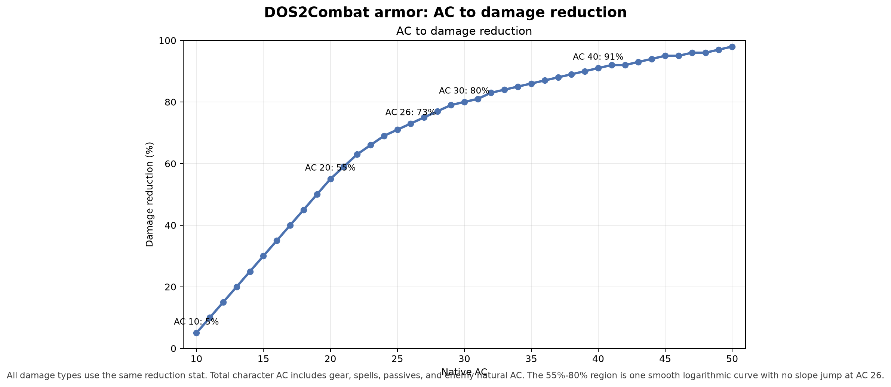

# DOS3 Mod Collection

Baldur's Gate 3 mods focused on DOS2-style combat, randomized enemies and
champions, higher enemy health, and convenient respec access.

## Mods

| Mod | Folder | Script Extender | Purpose |
| --- | --- | --- | --- |
| DOS2 Combat Overhaul | `mods/DOS2Combat` | Required | DOS2-style AP, armor resistance, deterministic damage, turn cooldowns, and combat stat rewrites |
| Enemy Randomization | `mods/EnemyRandomization` | Required | Random enemy buffs, themed champions, summoning variants, and generated champion loot |
| Enemy Health Multiplier | `mods/EnemyHealth` | Not required | Doubles base enemy health on Tactician by overriding the native difficulty boost |
| Respec Anywhere | `mods/RespecAnywhere` | Required | Opens Withers' native respec UI from a client panel or console command |

The mods can be used independently. Enemy Randomization is designed to work
alongside DOS2 Combat Overhaul, and Enemy Health uses the native Tactician
difficulty system so it stacks naturally with the other mods.

## Requirements

- Baldur's Gate 3 with the BG3 Script Extender (`DWrite.dll` in the game's
  `bin` folder) for all Lua-backed mods.
- BG3 Mod Manager or the in-game Mods menu.
- Python 3.12 only for the test suite and mod generators.
- LSLib/`Divine.exe` is downloaded automatically by `scripts/build.sh` if it is missing. Packaging is Windows-oriented.

## Installation

1. Install BG3 Script Extender for the Lua-backed mods.
2. Build or obtain the `.pak` files.
3. Copy them into:

   ```text
   %LOCALAPPDATA%\Larian Studios\Baldur's Gate 3\Mods
   ```

4. Enable the desired mods in BG3 Mod Manager or the in-game Mods menu.
5. Load a save. Runtime rules apply automatically; Enemy Health is a stats-only
   mod.

For a local source build:

```bash
./scripts/build.sh DOS2Combat
./scripts/build.sh EnemyRandomization
./scripts/build.sh EnemyHealth
./scripts/build.sh RespecAnywhere
```

Install the packaged files:

```bash
./scripts/install.sh DOS2Combat
./scripts/install.sh EnemyRandomization
./scripts/install.sh EnemyHealth
./scripts/install.sh RespecAnywhere
```

`build.sh` downloads LSLib into `tools/lslib` automatically if `Divine.exe` is
missing. `EnemyRandomization` regenerates its deterministic champion and loot
catalogs during `build.sh`. The generators require extracted BG3 data under
`.analysis`; that directory is intentionally gitignored.

The generated Enemy Randomization build inputs are committed to the repository
so GitHub Actions can package the mod without access to extracted BG3 data.
Local builds regenerate those inputs by default. Set `ENR_SKIP_GENERATION=1` to
make `build.sh` use the committed copies instead:

```bash
ENR_SKIP_GENERATION=1 ./scripts/build.sh EnemyRandomization
```

## Testing and CI/CD

Install developer dependencies:

```bash
python -m pip install -r requirements-dev.txt
```

Run the full source-level test suite:

```bash
./scripts/test.sh
```

Validate every mod's manifests, stats, Lua syntax, and localization:

```bash
python scripts/validate-mod.py --all
```

Run the Python lint and static type checks:

```bash
ruff check scripts tests
mypy --config-file mypy.ini scripts tests
```

Run Lua lint/static analysis/type diagnostics with LuaLS:

```bash
lua-language-server --check=mods --checklevel=Warning \
  --configpath="$PWD/.luarc.json" --logpath=/tmp/luals
python scripts/check-lua-types.py --luals "$(command -v lua-language-server)"
```

GitHub Actions runs:

- **CI** on Ubuntu: a dynamic matrix with one validation job per discovered mod,
  the shared full test suite, Ruff + Mypy, and LuaLS diagnostics/type checking.
- **CD** after a successful `master` CI run: a Windows packaging matrix builds
  all discovered mods with LSLib and replaces the single **latest** GitHub
  release with the new `.pak` assets.

CD keeps only one release, tagged `latest`; previous release assets and tags are
deleted before the new release is created. Packaging is not run on a clean
Ubuntu runner because LSLib requires Windows.

## DOS2 Combat Overhaul

### Combat rules

- Characters use a 4 AP starting pool, 6 AP maximum, and 4 AP regeneration per
  turn with carryover capped by the maximum.
- Basic weapon attacks cost 2 AP.
- Spells use DOS2-style level-based AP costs.
- Non-default spells have at least a one-turn cooldown.
- Cooldowns use DOS2-style turn counts. Out of combat, one turn is six seconds.
- Native attack rolls are removed, so weapon and spell attacks cannot miss.
- Saving throws are removed everywhere: spell/alternate rolls, status apply and
  tick rolls, functor conditions, and `ApplyStatus` condition arguments.
- All AC sources are converted into **one percentage damage-reduction stat**.
  There are no separate physical and magic armor buckets. Every damage type
  uses the same reduction.
- The formula gives 5% per AC above 9 through AC 20, then 2.5% per AC,
  capped at 70% from AC 26 onward: AC 10 = 5%, AC 14 = 25%, AC 20 = 55%,
  AC 26 = 70%. Shield items use their ArmorClass bonus directly.
- Enemy AC is converted into damage reduction instead of remaining as hit
  avoidance. A hidden no-dodge status also cancels AC from statuses, spells,
  and passives, including `ACOverrideFormula` effects.



The chart shows the AC-to-reduction mapping and the damage remaining after
reduction for several reduction values.

- Concentration is removed from spells.
- Damage ranges are compressed toward their average rather than fully
  flattened.

### Useful commands

```text
!dos2c_status                 # print AP, cooldown, armor, and patch state
!dos2c_ap                     # dump the host's ActionResources (current/max AP)
!dos2c_armor [guid]           # show percentage damage reduction for a character
!dos2c_setarmor <percent>      # override the host's damage reduction (0-100)
!dos2c_resetarmor             # clear and recompute reduction from AC/statuses
!dos2c_patch                  # reapply the stat patches and repair runtime AP
!dos2c_fixap                  # reapply the AP pool to existing-save characters
!dos2c_rolls on|off           # debug: restore native rolls / reapply no-roll rules
!dos2c_armorui on|off         # toggle the client damage-reduction overlay
!dos2c_debug on|off           # toggle verbose DOS2Combat logging
!dos2c_weapon                 # print equipped weapon stats and dice-roll data
```

Use `!dos2c_status` first when diagnosing a problem. The BG3SE console opens
with **Ctrl+F12**.

## Enemy Randomization

### Random buffs and champions

Eligible enemies can receive:

- One positive random status from the configured buff pool.
- A themed champion condition, subject to the champion chance.

Rolls are server-authoritative and use persistent markers so save/reload and
multiplayer clients do not reroll assignments.

There are two champion families:

- **Summoning champions** grant themed summon skills and use generated
  per-level characters and root templates.
- **Non-summoning champions** grant statuses, passives, and spells directly.

Summoning themes include Dinosaurs, Spiders, Goblins, Ogres, Hell, Steel Watch,
Dragons, Gnolls, Mind Flayers, Bugbears, Redcaps, Constructs, Monstrosities,
and Owlbears. Non-summoning themes include Vitality, Lightning, Light, the Hunt,
Resilience, Fire, Frost, Venom, Death, Thunder, the Mind, the Arcane, War, the
Wild, and the Sun.

Summon skills currently cost **4 AP** and have a **5-turn cooldown**. Cooldowns
are per caster and enforced by removing/re-granting the summon skill while the
cooldown is active. Summoned enemies use a separate **3 AP per turn** economy
and spawn with BG3's **lethargic** status, so their first turn is a setup/wait
turn.

### Champion chance

The champion chance is a decimal from **0.0 to 1.0**:

```text
0.0   = champions disabled
0.125 = 12.5% chance
0.5   = 50% chance
1.0   = every eligible enemy becomes a champion
```

```text
!enemyrandom_chance 0.125    # set champion chance (0-1 decimal, persisted)
!enemyrandom_status          # print the current champion chance
!enemyrandom_reset           # clear champion markers and reroll eligible enemies
!enemyrandom_apply           # force another buff/champion scan now
```

Values such as `12.5` are rejected. The setting persists in the savegame and is
synchronized from the host to clients.

The current default is `1.0` for testing. A normal gameplay value is
approximately `0.125`.

### Loot testing commands

```text
!enemyrandom_loot                 # one item using the normal rarity roll
!enemyrandom_loot rare            # force one Rare item
!enemyrandom_loot legendary 5     # spawn five Legendary items
!enemyrandom_loot boss            # one guaranteed Very Rare/Legendary item
!enemyrandom_loot boss 2          # two guaranteed boss-tier items
!enemyrandom_drop                 # alias for !enemyrandom_loot
```

The optional rarity is `uncommon`, `rare`, `veryrare`, `legendary`, or `boss`.
The second number is the spawn count, capped at 20. Without arguments the
normal champion rarity table is used.

Print every summoning champion and its summon list:

```text
!enemyrandom_summons    # list every summoning champion and its summon skills
```

### Champion loot

Every champion drops one item per active champion condition. Bosses are
guaranteed Very Rare or Legendary drops.

Normal champion rarity chance:

```text
Uncommon  60%
Rare      20%
Very Rare 15%
Legendary  5%
```

Boss rarity chance:

```text
Very Rare 75%
Legendary 25%
```

Loot rules:

| Rarity | Granted properties |
| --- | --- |
| Uncommon | 1 category slot: spell, condition, or ability boost (+1) |
| Rare | 2 category slots; ability boost is +1 when selected |
| Very Rare | 1 spell, 2 conditions, and ability boost (+1) |
| Legendary | 2 spells, 2 conditions, and ability boost (+2) |

Granted spell levels are capped by player level:

| Player level | Maximum spell level |
| ---: | ---: |
| 1-2 | 1 |
| 3-4 | 2 |
| 5-6 | 3 |
| 7-8 | 4 |
| 9-10 | 5 |
| 11+ | 6 |

Spells are existing BG3 spells. Conditions are permanent positive native
statuses while the item is equipped. Ability boosts are capped at 20. Loot
keeps the base item's name, icon, and visual while overriding its rarity.

The loot catalog is generated deterministically at build time. The generated
catalog is committed so CD can package it without extracted BG3 data; local
`./scripts/build.sh EnemyRandomization` regenerates it from `.analysis` unless
`ENR_SKIP_GENERATION=1` is set.

### Saves and multiplayer

- The host is authoritative for rolls and champion assignment.
- Persistent markers prevent rerolling after save/reload.
- Existing buffs and champions are adopted rather than rerolled.
- Champion chance is a synchronized ModVar.
- Clients see the same replicated statuses, spells, and summoned actors.

## Enemy Health Multiplier

`EnemyHealth` is a **stats-only Tactician mod**. It overrides the native
`HEALTHBOOST_HARDCORE` status:

```text
IncreaseMaxHP(30%) -> IncreaseMaxHP(100%)
```

This makes enemy base health **2×** on Tactician while preserving the native
Tactician attack-roll and spell-save bonuses. It has no runtime Script Extender
code, no health markers, and no save/reload scan loop.

It only applies on Tactician. Balanced and Easy are unchanged. Previously
scaled enemies in an old save may retain their previous health; use a new save
or clean that save if health appears higher than expected.

## Respec Anywhere

**Respec Anywhere** is a separate mod. It adds a small **DOS2 Tools** panel with
a **Respec character** button and a console command:

```text
!respec    # open Withers' respec UI for the host character
```

The command opens Withers' native respec UI for the host character from
anywhere in-game. The main menu cannot respec because no character is loaded
there.

The mod routes multiplayer requests from the requesting player to their own
character rather than the host or all players.

## Troubleshooting

### The console does not open

- Confirm BG3SE is installed in the game's `bin` folder.
- Confirm the relevant `.pak` files are enabled in Mod Manager.
- Check the Script Extender log directory:

  ```text
  %LOCALAPPDATA%\Larian Studios\Baldur's Gate 3\Script Extender Logs
  ```

### A command is not recognized

Commands are registered by server-side Lua files. Make sure the relevant mod is
enabled before loading the save.

### Champion chance did not take effect

- Confirm the command reported the new value.
- Enemies with the champion marker do not reroll.
- Use a new encounter or a save made before the champion roll.

### Enemy Health does not apply

- Confirm the game is set to Tactician.
- Confirm `EnemyHealth.pak` is enabled.
- Existing saves created with the old runtime health implementation may retain
  already-scaled health.

### Multiplayer differences

The host is authoritative. If a client appears out of sync:

1. Confirm the host and client use the same mod versions.
2. Have the host run `!enemyrandom_status`.
3. Reload the client after the host has loaded the save.

## Repository Layout

```text
AGENTS.md               coding-agent and contributor guardrails
GLOSSARY.md             BG3/DOS2/BG3SE terminology
docs/ARCHITECTURE.md    module and event-flow reference
mods/
  DOS2Combat/           DOS2 combat rules and client UI
  EnemyHealth/          Tactician HEALTHBOOST_HARDCORE override
  EnemyRandomization/   champions, summons, loot, random buffs
  RespecAnywhere/       respec panel and command
scripts/
  build.sh              package a mod with LSLib
  install.sh            copy a package to the BG3 Mods folder
  validate-mod.py       source validation for one mod or --all
  test.sh               full Python test suite
  generate-enr-*.py     deterministic Enemy Randomization generators
  generate-armor-passives.py  AC armor tooltip passive catalog
tests/                  unittest and Lua harness tests
.github/workflows/ci.yml dynamic mod validation matrix and test suite
.github/workflows/cd.yml package all mods and replace the latest release
```

## Developer Documentation

- `AGENTS.md` - repository guardrails for coding agents and new contributors
- `GLOSSARY.md` - BG3/DOS2/BG3SE and project terminology
- `docs/ARCHITECTURE.md` - module boundaries, load order, event flow, and build pipeline
- `TODO.md` - implementation backlog and in-game verification checklist
- `mods/EnemyRandomization/CHAMPION_DESIGN.md` - champion, summon, and loot architecture
- `tests/README.md` - test coverage and limitations
